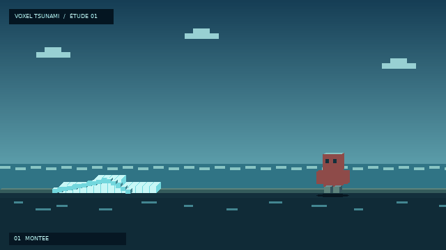

# Deep Lucky Block — NeoForge 1.21.1

## Aperçu voxel : vague déferlante

- [Ouvrir l’animation HTML interactive sur GitHub](https://htmlpreview.github.io/?https://github.com/Deepie1/dlbv1.21.1neoforge/blob/arena/b36d3c28-dlbv1-21-1neoforge/docs/index.html)
- [Consulter le fichier HTML dans le dépôt](https://github.com/Deepie1/dlbv1.21.1neoforge/blob/arena/b36d3c28-dlbv1-21-1neoforge/docs/index.html)
- [Source Java autonome](https://github.com/Deepie1/dlbv1.21.1neoforge/blob/arena/b36d3c28-dlbv1-21-1neoforge/scratch/voxel-tsunami-preview/VoxelTsunamiPreview.java)

## Dernière archive de modifications gameplay

[**Télécharger directement `src-modifies-t301-t374.zip`**](https://github.com/Deepie1/dlbv1.21.1neoforge/raw/refs/heads/arena/b36d3c28-dlbv1-21-1neoforge/src-modifies-t301-t374.zip)

Cette archive contient les modifications source incrémentales jusqu’à T374; elle comprend le PDF recalculé, accents harmonisés et verrouillage des couleurs d’animation sur les palettes de chaque famille. Ce n’est pas un fichier mod `.jar` compilé. Le PDF est également disponible seul sous `docs/Palette_couleurs_animations_elementaires.pdf`.

[Télécharger aussi le PDF séparément](https://github.com/Deepie1/dlbv1.21.1neoforge/raw/refs/heads/arena/b36d3c28-dlbv1-21-1neoforge/docs/Palette_couleurs_animations_elementaires.pdf).
